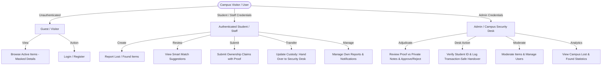
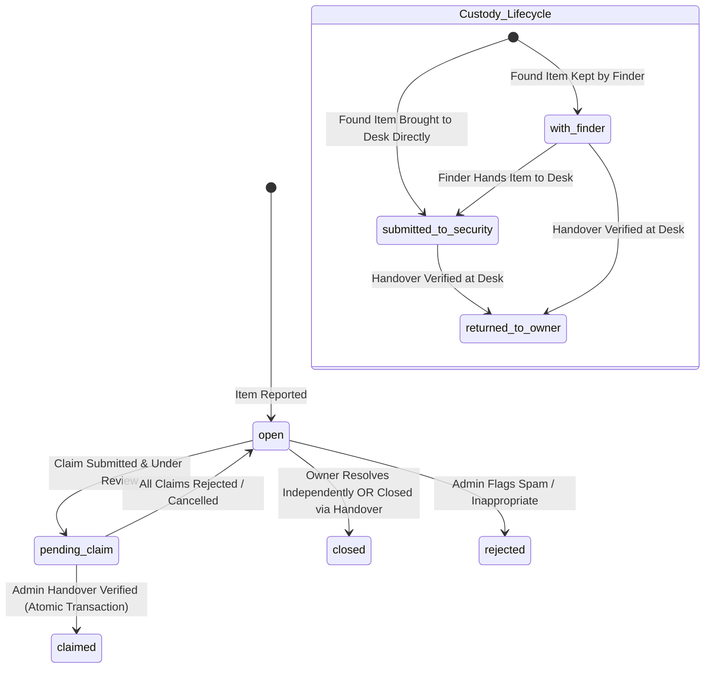
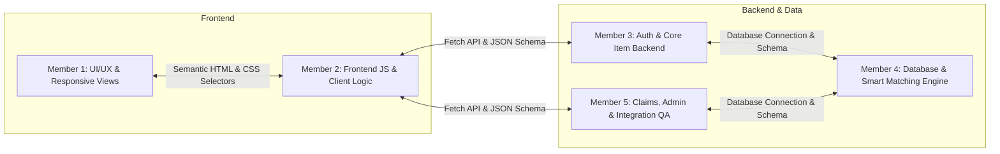
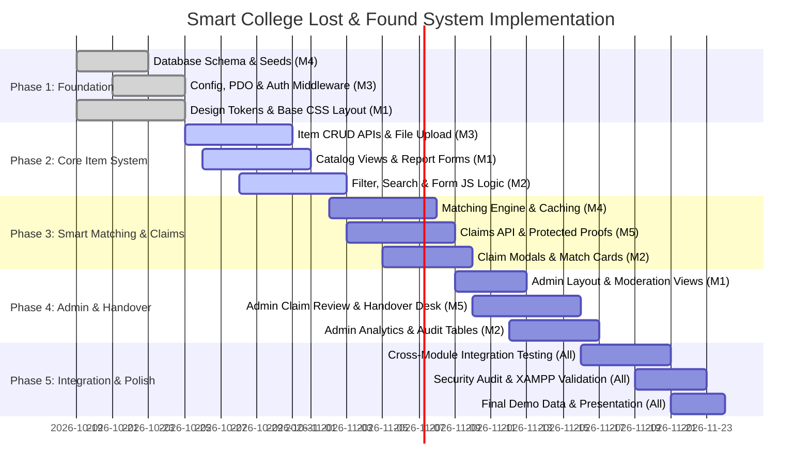

# Smart College Lost and Found System (SCLFS)
## Final Architecture & Engineering Specification

**Project Name:** Smart College Lost and Found System  
**Target Environment:** Local XAMPP (Apache 2.4+, PHP 8.1+, MySQL 8.0+ / MariaDB 10.4+)  
**Technology Stack:** Plain PHP with PDO, Vanilla JavaScript (ES6+), Semantic HTML5, CSS3, MySQL  
**Collaboration Platform:** GitHub  
**Team Size:** 5 Members  
**Document Version:** 2.0.0 (Fully Finalized & Approved)  
**Status:** Approved Architecture Specification — Locked for Implementation  

---

## Table of Contents
1. [Project Objectives & Requirements](#1-project-objectives--requirements)
2. [User Roles & User Flows](#2-user-roles--user-flows)
3. [Complete Page List & Feature Breakdown](#3-complete-page-list--feature-breakdown)
4. [MySQL Database Schema & Relationships](#4-mysql-database-schema--relationships)
5. [Standard Status Values, Lifecycles & Validation Rules](#5-standard-status-values-lifecycles--validation-rules)
6. [Proposed Project Directory Structure](#6-proposed-project-directory-structure)
7. [PHP Endpoint Contracts & API Communication Architecture](#7-php-endpoint-contracts--api-communication-architecture)
8. [Security & Data Protection Specifications](#8-security--data-protection-specifications)
9. [Five-Member Work Division & Interface Boundaries](#9-five-member-work-division--interface-boundaries)
10. [Minimum Viable Product (MVP), Phased Roadmap & Enhancements](#10-minimum-viable-product-mvp-phased-roadmap--enhancements)
11. [GitHub Workflow, Integration Protocol & Testing Standards](#11-github-workflow-integration-protocol--testing-standards)
12. [Finalized Decisions, Production Checklist & Git Commands](#12-finalized-decisions-production-checklist--git-commands)

---

## 1. Project Objectives & Requirements

### 1.1 Problem Statement
Campus communities routinely struggle with lost personal belongings (laptops, student IDs, keys, wallets, course books). Informal methods like WhatsApp/Telegram group chats or physical notice boards suffer from:
- Excessive spam and rapidly buried messages.
- Zero structured categorisation or location-based querying.
- High risk of fraudulent claims when distinguishing details are published openly.
- Complete absence of tracking for physical items turned into security desks.
- Lack of transaction-safe audit trails when returning property.

### 1.2 Core Objectives
1. Provide a centralized, searchable campus portal for reporting lost and found items.
2. Implement an automated **Smart Matching Engine** calculating a **heuristic similarity score** (0 to 100 points, not a statistical probability) between lost and found items on-demand, caching scores to eliminate unnecessary repeated computation.
3. Protect campus property by hiding sensitive distinguishing marks from public listings and requiring claimants to describe proof details, with **mandatory admin authorization** before claim approval.
4. Provide explicit **Custody Tracking** supporting both finder-held items and items surrendered to the campus security desk, through to physical handover.
5. Guarantee **Atomic, Transaction-Safe Handovers**: When an administrator verifies a physical handover, the item status, claim handover timestamp, and any linked lost report closure are processed within a single ACID transaction with row-level locks, preventing duplicate or conflicting handovers.
6. Retain notifications indefinitely for the MVP with pagination and mark-as-read capabilities, requiring no background cron or purge scheduler.
7. Maintain a lightweight, plain PHP (PDO) and MySQL architecture that runs effortlessly on local XAMPP without external runtime dependencies.

### 1.3 Functional Requirements (FR)
- **FR-01 (Authentication & Accounts):** Student/staff registration with Student Roll Number, name, department, phone, and email. Email domain validation is governed by a configuration toggle (`ENFORCE_COLLEGE_EMAIL_DOMAIN`), allowing general emails during local development and strictly enforcing `@college.edu` regex for deployment.
- **FR-02 (Lost Item Reporting):** Authenticated users report lost items specifying category, campus location, date/time lost, description, and optional reference photos.
- **FR-03 (Found Item Reporting & Custody):** Authenticated users report found items specifying category, found location, date/time, public photo, initial custody (`with_finder` or `submitted_to_security`), and **private identifying features** (strictly hidden from public view).
- **FR-04 (Public Catalog & Search):** Guests and logged-in users can browse active items with multi-parameter filtering (type, category, campus building, custody, date range, status, and live search).
- **FR-05 (On-Demand Smart Matching):** On-demand calculation of a heuristic similarity score (0–100 pts) computed when reports are filed or updated. Scores meeting the configurable threshold (`MATCH_SCORE_THRESHOLD = 40.0`) are persisted in `smart_matches`, allowing page views to read cached matches instantly ($O(1)$ indexed lookup).
- **FR-06 (Ownership Claims Workflow):** Claimants submit ownership claims describing distinguishing marks and attaching optional proof photos/receipts.
- **FR-07 (Admin Claim Adjudication):** Only authorized administrators can review proof against private marks and approve/reject claims.
- **FR-08 (Security Desk Handover Verification & Auto-Closure):** Security desk staff verify student ID physically, complete handover in an atomic transaction, update custody to `returned_to_owner`, close linked lost reports, dispatch in-app notifications, and record audit logs.
- **FR-09 (In-App Notifications):** Notification center alerting users on smart match suggestions, claim status updates, custody transfers, and handover completions. Retained indefinitely for MVP with read/unread flags and pagination.
- **FR-10 (Admin Dashboard & Analytics):** Centralized administration for metrics (recovery rate %, active inventory), item moderation, claim verification, and user management.

### 1.4 Non-Functional Requirements (NFR)
- **NFR-01 (Performance):** Page load times < 1.5s on local XAMPP; API filter/search queries < 200ms using MySQL composite indexes.
- **NFR-02 (Compatibility):** Runs out-of-the-box on standard XAMPP (Apache 2.4, PHP 8.1+, MySQL 8.0+ / MariaDB 10.4+) across Windows, macOS, and Linux without Composer or Node.js runtime dependencies.
- **NFR-03 (Security & Hardening):** Strict prepared statements (PDO), contextual HTML escaping (XSS), CSRF tokens on all mutations, and `.htaccess` execution blocking on upload folders.
- **NFR-04 (Responsive UI):** Mobile-first layouts adapting cleanly from mobile viewports (360px) to desktop monitors (1920px).
- **NFR-05 (Code Quality & Modularity):** Clear separation between UI views, JavaScript API clients, REST-like PHP controllers, and shared service classes.

---

## 2. User Roles & User Flows

### 2.1 User Roles


1. **Guest (Unauthenticated User):**
   - Can view the landing page and browse active lost and found items.
   - Private identifying features and finder contact details are strictly masked.
   - Cannot file reports, submit claims, or receive notifications.
2. **Student / Staff (Authenticated Regular User):**
   - Can report lost items and found items.
   - Can specify custody (`with_finder` or `submitted_to_security`) and update custody if subsequently handed to security.
   - For found items, provides private identifying features that remain invisible to the public.
   - Receives automatic match notifications when compatible items are posted.
   - Can submit an ownership claim with supporting evidence.
   - Can mark their own lost items as resolved.
3. **Admin / Campus Security Desk Officer:**
   - Possesses full administrative oversight of all reports, users, and audit logs.
   - Compares claimant's submitted proof with the finder's private identifying features.
   - **Exclusively authorized to approve or reject claims** (preventing unauthorized finder collusion).
   - Manages physical handovers at the security desk by verifying student ID cards and logging handover records.
   - Moderates inappropriate posts and suspends abusive accounts.

### 2.2 Core User Flows

#### Flow A: Lost Item Reporting & Smart Match Suggestions
```
[Student loses item on campus]
       │
       ▼
[Log in & Open "Report Lost Item"]
       │
       ▼
[Enter Title, Category, Building, Date Lost, Description, Photo]
       │
       ▼
[Submit Form via Fetch API] ──► [Server validates & inserts into `items`]
                                       │
                                       ▼
                       [Trigger MatchingService::findMatchesForItem]
                                       │
                      ┌────────────────┴────────────────┐
                      ▼                                 ▼
             [Query Open Found Items           [Calculate 4-Factor Heuristic
              in Same/Related Categories]       Score: Category + Location +
                      │                         Date Proximity + Keywords]
                      │                                 │
                      └────────────────┬────────────────┘
                                       ▼
                         [Score >= MATCH_SCORE_THRESHOLD (40%)]
                                  /         \
                              Yes/           \No
                                ▼             ▼
                     [Insert/Update in           [End]
                      `smart_matches`]
                                │
                                ▼
                     [Send Notification to
                      Owner & Finder]
```

#### Flow B: Found Item, Custody Tracking, Admin Approval & Atomic Handover
```
[Student finds item (e.g. calculator in Lab)]
       │
       ▼
[Log in & Open "Report Found Item"]
       │
       ▼
[Public Details: Title, Category, Location, Date, Public Photo]
[Custody: "with_finder" OR "submitted_to_security"]
[Private Markings: Secret serial number, engraving, or specific contents]
       │
       ▼
[Item saved as status='open']
(Public view displays item; private markings are NEVER rendered publicly)
       │
       ▼
[Potential owner views item (via Search or Match Notification)]
       │
       ▼
[Clicks "Claim Item" -> Fills proof description & optional proof photo]
       │
       ▼
[Claim saved as status='pending' -> Notification sent to Admin & Finder]
       │
       ▼
[AUTHORIZED ADMIN REVIEW]
Admin opens `admin/manage-claims.php` and compares:
  - Claimant's submitted proof description & receipt photo
  - Finder's secret private identifying features
       │
       ├──────────────┬──────────────┐
       ▼              ▼              ▼
  [Approve Claim] [Request Info]   [Reject Claim]
       │              │              │
       │         [Under Review]   [Status='rejected']
       ▼                             │
[Claim status='approved']         [Notification to claimant]
[Item status='pending_claim']
       │
       ▼
[Claimant visits Campus Security Desk with Student ID Card]
       │
       ▼
[ATOMIC PHYSICAL HANDOVER TRANSACTION]
Security Officer checks Student ID via `admin/handover.php`
Server executes PDO transaction with Row Locks (FOR UPDATE):
  1. Lock & verify Claim status='approved' AND handover_date IS NULL
  2. Lock & verify Item status IN ('open','pending_claim')
  3. Update Claim: handover_date = NOW()
  4. Update Item: status='claimed', custody_status='returned_to_owner'
  5. IF linked lost_item_id EXISTS:
       Update Lost Item: status='closed'
       Insert Notification to Lost Item Owner
  6. Insert Notification to Finder (Handover Completed)
  7. Insert Audit Log (HANDOVER_COMPLETED)
  8. Commit Transaction (Rollback on any error)
```

---

## 3. Complete Page List & Feature Breakdown

| Page File | Target Route | Access Level | Key Features & Responsibilities |
|---|---|---|---|
| `index.php` | `/index.php` | Public | Campus hero banner, live search bar, real-time KPI counters (Total Reported, Reunited, Active Items), recent items ticker, how-it-works cards. |
| `login.php` | `/login.php` | Guest Only | Student/Admin login, email & password authentication, remember me, link to registration, one-click demo credentials for local evaluation. |
| `register.php` | `/register.php` | Guest Only | Student registration: Full Name, Student Roll No, Department, Email (validation governed by config), Phone, Password, Confirm Password. |
| `items.php` | `/items.php` | Public / All | Master catalog. Multi-filters: Type (All/Lost/Found), Custody (`with_finder`/`submitted_to_security`), Category, Building, Date Range, Status. Debounced live search, responsive cards, async pagination. |
| `item-details.php` | `/item-details.php?id={id}` | Public / All | Detailed item view, high-resolution image modal, date, campus location, custody badge. **Private identifying features are hidden from public**. Shows "Claim Item" button for found items. |
| `dashboard.php` | `/dashboard.php` | Authenticated | Student command center: KPI cards (My Active Lost, My Active Found, Pending Claims, Unread Alerts), top smart match suggestions cards, quick report action buttons. |
| `report-lost.php` | `/report-lost.php` | Authenticated | Form to report lost item: Title, Category, Campus Building, Specific Area, Incident Date/Time, Detailed Description, Photo upload. |
| `report-found.php` | `/report-found.php` | Authenticated | Form to report found item: Title, Category, Location, Incident Date/Time, Public Image, Custody selection (`with_finder` / `submitted_to_security`), **Secret Identifying Features** field. |
| `my-reports.php` | `/my-reports.php` | Authenticated | Tabbed list of reports filed by current user. Edit details, mark resolved, update custody from `with_finder` to `submitted_to_security`, view matched items. |
| `claims.php` | `/claims.php` | Authenticated | Dual-panel tracking: 1. "Claims I Have Submitted" (status badge, admin notes). 2. "Claims Received on Items I Found" (read-only claimant summary). |
| `notifications.php` | `/notifications.php` | Authenticated | In-app notification center: paginated list of alerts, mark single/all as read, direct navigation links to relevant matches or claims. Retained indefinitely for MVP. |
| `profile.php` | `/profile.php` | Authenticated | View/edit phone and department, change password, view activity log. |
| `admin/index.php` | `/admin/index.php` | Admin Only | Master executive dashboard: recovery success rate %, pending claims requiring review, active custody breakdown, category pie chart, recent audit logs. |
| `admin/manage-items.php` | `/admin/manage-items.php` | Admin Only | Administrative item control table: view full details (including secret private features), edit custody, delete spam, change item status. |
| `admin/manage-claims.php` | `/admin/manage-claims.php` | Admin Only | **Sole claim adjudication interface**: side-by-side comparison of claimant proof vs finder's private features; approve/reject actions with admin notes. |
| `admin/handover.php` | `/admin/handover.php` | Admin Only | Security desk physical handover terminal: lookup by Claim ID or Student Roll No, physical ID card verification checklist, atomic one-click handover completion. |
| `admin/users.php` | `/admin/users.php` | Admin Only | User administration: search students/staff by roll number or email, toggle active/suspended status, view user report history. |

---

## 4. MySQL Database Schema & Relationships

### 4.1 Entity Relationship Diagram (ERD)

```mermaid
erDiagram
    USERS ||--o{ ITEMS : "reports"
    USERS ||--o{ CLAIMS : "submits"
    USERS ||--o{ CLAIMS : "reviews_as_admin"
    USERS ||--o{ NOTIFICATIONS : "receives"
    USERS ||--o{ AUDIT_LOGS : "performs"
    CATEGORIES ||--o{ ITEMS : "classifies"
    LOCATIONS ||--o{ ITEMS : "locates"
    ITEMS ||--o{ SMART_MATCHES : "as_lost_item"
    ITEMS ||--o{ SMART_MATCHES : "as_found_item"
    ITEMS ||--o{ CLAIMS : "item_claimed"
    ITEMS ||--o? CLAIMS : "claimant_lost_item"

    USERS {
        int id PK
        string role "student, staff, admin"
        string student_id "Unique Roll Number"
        string full_name
        string email UK
        string password_hash
        string phone
        string department
        string status "active, suspended"
        timestamp created_at
        timestamp updated_at
    }

    CATEGORIES {
        int id PK
        string name UK
        string icon
        string description
        timestamp created_at
    }

    LOCATIONS {
        int id PK
        string campus_zone
        string building
        string specific_area
        timestamp created_at
    }

    ITEMS {
        int id PK
        int user_id FK
        string item_type "lost, found"
        int category_id FK
        int location_id FK
        string title
        text description
        text identifying_features "Private verification markings"
        date incident_date
        time incident_time
        string image_path
        string custody_status "with_finder, submitted_to_security, returned_to_owner, not_applicable"
        string status "open, pending_claim, claimed, closed, rejected"
        timestamp created_at
        timestamp updated_at
    }

    SMART_MATCHES {
        int id PK
        int lost_item_id FK
        int found_item_id FK
        decimal match_score "Heuristic Score 0.00 - 100.00"
        json score_breakdown
        string status "suggested, viewed, confirmed, dismissed"
        timestamp calculated_at
        timestamp created_at
    }

    CLAIMS {
        int id PK
        int item_id FK "Found Item"
        int claimant_id FK
        int lost_item_id FK "Optional Lost Item"
        text proof_description
        string proof_image_path
        string status "pending, under_review, approved, rejected, cancelled"
        text admin_notes
        int reviewed_by_admin_id FK
        datetime reviewed_at
        datetime handover_date
        timestamp created_at
        timestamp updated_at
    }

    NOTIFICATIONS {
        int id PK
        int user_id FK
        string title
        text message
        string type "match_found, claim_received, claim_status, custody_update, admin_alert"
        int reference_id
        string reference_url
        tinyint is_read
        timestamp created_at
    }

    AUDIT_LOGS {
        int id PK
        int user_id FK
        string action
        string target_type
        int target_id
        json details
        string ip_address
        timestamp created_at
    }
```

### 4.2 Complete DDL Schema (`database/schema.sql`)

```sql
-- Smart College Lost and Found System (SCLFS) Database Schema
-- Compatible with MySQL 8.0+ and MariaDB 10.4+ on XAMPP

SET FOREIGN_KEY_CHECKS = 0;
DROP TABLE IF EXISTS audit_logs;
DROP TABLE IF EXISTS notifications;
DROP TABLE IF EXISTS claims;
DROP TABLE IF EXISTS smart_matches;
DROP TABLE IF EXISTS items;
DROP TABLE IF EXISTS locations;
DROP TABLE IF EXISTS categories;
DROP TABLE IF EXISTS users;
SET FOREIGN_KEY_CHECKS = 1;

-- 1. USERS TABLE
CREATE TABLE users (
    id INT UNSIGNED AUTO_INCREMENT PRIMARY KEY,
    role ENUM('student', 'staff', 'admin') NOT NULL DEFAULT 'student',
    student_id VARCHAR(30) NULL UNIQUE COMMENT 'College Roll Number / Staff ID',
    full_name VARCHAR(100) NOT NULL,
    email VARCHAR(120) NOT NULL UNIQUE,
    password_hash VARCHAR(255) NOT NULL COMMENT 'Bcrypt / Argon2 hash - Plaintext strictly prohibited',
    phone VARCHAR(20) NOT NULL,
    department VARCHAR(100) NULL,
    status ENUM('active', 'suspended') NOT NULL DEFAULT 'active',
    created_at TIMESTAMP DEFAULT CURRENT_TIMESTAMP,
    updated_at TIMESTAMP DEFAULT CURRENT_TIMESTAMP ON UPDATE CURRENT_TIMESTAMP,
    INDEX idx_user_role_status (role, status),
    INDEX idx_user_email (email)
) ENGINE=InnoDB DEFAULT CHARSET=utf8mb4 COLLATE=utf8mb4_unicode_ci;

-- 2. CATEGORIES TABLE
CREATE TABLE categories (
    id INT UNSIGNED AUTO_INCREMENT PRIMARY KEY,
    name VARCHAR(50) NOT NULL UNIQUE,
    icon VARCHAR(50) NOT NULL DEFAULT 'fa-box',
    description VARCHAR(255) NULL,
    created_at TIMESTAMP DEFAULT CURRENT_TIMESTAMP
) ENGINE=InnoDB DEFAULT CHARSET=utf8mb4 COLLATE=utf8mb4_unicode_ci;

-- 3. CAMPUS LOCATIONS TABLE
CREATE TABLE locations (
    id INT UNSIGNED AUTO_INCREMENT PRIMARY KEY,
    campus_zone VARCHAR(60) NOT NULL COMMENT 'e.g. North Campus, Engineering Block',
    building VARCHAR(80) NOT NULL COMMENT 'e.g. Central Library, Science Complex',
    specific_area VARCHAR(100) NULL COMMENT 'e.g. 2nd Floor Reading Room, Lab 102',
    created_at TIMESTAMP DEFAULT CURRENT_TIMESTAMP,
    INDEX idx_building (building)
) ENGINE=InnoDB DEFAULT CHARSET=utf8mb4 COLLATE=utf8mb4_unicode_ci;

-- 4. ITEMS TABLE (Core Lost & Found Reports with Custody Tracking)
CREATE TABLE items (
    id INT UNSIGNED AUTO_INCREMENT PRIMARY KEY,
    user_id INT UNSIGNED NOT NULL,
    item_type ENUM('lost', 'found') NOT NULL,
    category_id INT UNSIGNED NOT NULL,
    location_id INT UNSIGNED NOT NULL,
    title VARCHAR(120) NOT NULL,
    description TEXT NOT NULL,
    identifying_features TEXT NULL COMMENT 'Private verification features - STRICTLY HIDDEN FROM PUBLIC',
    incident_date DATE NOT NULL COMMENT 'Date lost or date found',
    incident_time TIME NULL,
    image_path VARCHAR(255) NULL,
    custody_status ENUM('with_finder', 'submitted_to_security', 'returned_to_owner', 'not_applicable') NOT NULL DEFAULT 'not_applicable',
    status ENUM('open', 'pending_claim', 'claimed', 'closed', 'rejected') NOT NULL DEFAULT 'open',
    created_at TIMESTAMP DEFAULT CURRENT_TIMESTAMP,
    updated_at TIMESTAMP DEFAULT CURRENT_TIMESTAMP ON UPDATE CURRENT_TIMESTAMP,
    CONSTRAINT fk_items_user FOREIGN KEY (user_id) REFERENCES users (id) ON DELETE CASCADE,
    CONSTRAINT fk_items_category FOREIGN KEY (category_id) REFERENCES categories (id) ON DELETE RESTRICT,
    CONSTRAINT fk_items_location FOREIGN KEY (location_id) REFERENCES locations (id) ON DELETE RESTRICT,
    INDEX idx_items_type_status (item_type, status),
    INDEX idx_items_custody (custody_status),
    INDEX idx_items_date (incident_date),
    INDEX idx_items_cat_loc (category_id, location_id),
    FULLTEXT INDEX ft_item_search (title, description)
) ENGINE=InnoDB DEFAULT CHARSET=utf8mb4 COLLATE=utf8mb4_unicode_ci;

-- 5. SMART MATCHES TABLE (On-Demand Cached Heuristic Similarity Scores)
CREATE TABLE smart_matches (
    id INT UNSIGNED AUTO_INCREMENT PRIMARY KEY,
    lost_item_id INT UNSIGNED NOT NULL,
    found_item_id INT UNSIGNED NOT NULL,
    match_score DECIMAL(5,2) NOT NULL COMMENT 'Heuristic similarity score 0.00 to 100.00 (not a probability)',
    score_breakdown JSON NULL COMMENT 'Sub-scores: category, location, date, keyword',
    status ENUM('suggested', 'viewed', 'confirmed', 'dismissed') NOT NULL DEFAULT 'suggested',
    calculated_at TIMESTAMP DEFAULT CURRENT_TIMESTAMP ON UPDATE CURRENT_TIMESTAMP,
    created_at TIMESTAMP DEFAULT CURRENT_TIMESTAMP,
    CONSTRAINT fk_matches_lost FOREIGN KEY (lost_item_id) REFERENCES items (id) ON DELETE CASCADE,
    CONSTRAINT fk_matches_found FOREIGN KEY (found_item_id) REFERENCES items (id) ON DELETE CASCADE,
    UNIQUE KEY uk_match_pair (lost_item_id, found_item_id),
    INDEX idx_matches_score (match_score),
    INDEX idx_matches_status (status)
) ENGINE=InnoDB DEFAULT CHARSET=utf8mb4 COLLATE=utf8mb4_unicode_ci;

-- 6. CLAIMS TABLE (Ownership Claims Requiring Admin Review & Handover Verification)
CREATE TABLE claims (
    id INT UNSIGNED AUTO_INCREMENT PRIMARY KEY,
    item_id INT UNSIGNED NOT NULL COMMENT 'The found item being claimed',
    claimant_id INT UNSIGNED NOT NULL,
    lost_item_id INT UNSIGNED NULL COMMENT 'Optional linked lost item report (auto-closed upon handover)',
    proof_description TEXT NOT NULL COMMENT 'Claimant detailed description of distinguishing features',
    proof_image_path VARCHAR(255) NULL COMMENT 'Protected invoice, receipt, or matching photo',
    status ENUM('pending', 'under_review', 'approved', 'rejected', 'cancelled') NOT NULL DEFAULT 'pending',
    admin_notes TEXT NULL COMMENT 'Notes entered by reviewing administrator',
    reviewed_by_admin_id INT UNSIGNED NULL COMMENT 'Admin who approved or rejected the claim',
    reviewed_at DATETIME NULL,
    handover_date DATETIME NULL COMMENT 'Timestamp when physical item was handed over (prevents duplicate handover)',
    created_at TIMESTAMP DEFAULT CURRENT_TIMESTAMP,
    updated_at TIMESTAMP DEFAULT CURRENT_TIMESTAMP ON UPDATE CURRENT_TIMESTAMP,
    CONSTRAINT fk_claims_item FOREIGN KEY (item_id) REFERENCES items (id) ON DELETE CASCADE,
    CONSTRAINT fk_claims_claimant FOREIGN KEY (claimant_id) REFERENCES users (id) ON DELETE CASCADE,
    CONSTRAINT fk_claims_lost_item FOREIGN KEY (lost_item_id) REFERENCES items (id) ON DELETE SET NULL,
    CONSTRAINT fk_claims_admin FOREIGN KEY (reviewed_by_admin_id) REFERENCES users (id) ON DELETE SET NULL,
    INDEX idx_claims_status (status),
    INDEX idx_claims_item (item_id),
    INDEX idx_claims_handover (handover_date)
) ENGINE=InnoDB DEFAULT CHARSET=utf8mb4 COLLATE=utf8mb4_unicode_ci;

-- 7. NOTIFICATIONS TABLE (Retained Indefinitely for MVP with Pagination)
CREATE TABLE notifications (
    id INT UNSIGNED AUTO_INCREMENT PRIMARY KEY,
    user_id INT UNSIGNED NOT NULL,
    title VARCHAR(150) NOT NULL,
    message TEXT NOT NULL,
    type ENUM('match_found', 'claim_received', 'claim_status', 'custody_update', 'admin_alert', 'system') NOT NULL,
    reference_id INT UNSIGNED NULL,
    reference_url VARCHAR(255) NULL,
    is_read TINYINT(1) NOT NULL DEFAULT 0,
    created_at TIMESTAMP DEFAULT CURRENT_TIMESTAMP,
    CONSTRAINT fk_notifications_user FOREIGN KEY (user_id) REFERENCES users (id) ON DELETE CASCADE,
    INDEX idx_user_unread (user_id, is_read),
    INDEX idx_user_created (user_id, created_at DESC)
) ENGINE=InnoDB DEFAULT CHARSET=utf8mb4 COLLATE=utf8mb4_unicode_ci;

-- 8. AUDIT LOGS TABLE
CREATE TABLE audit_logs (
    id INT UNSIGNED AUTO_INCREMENT PRIMARY KEY,
    user_id INT UNSIGNED NULL,
    action VARCHAR(60) NOT NULL COMMENT 'e.g. CLAIM_APPROVED, HANDOVER_COMPLETED, CUSTODY_UPDATED',
    target_type VARCHAR(30) NOT NULL COMMENT 'item, claim, user',
    target_id INT UNSIGNED NOT NULL,
    details JSON NULL,
    ip_address VARCHAR(45) NULL,
    created_at TIMESTAMP DEFAULT CURRENT_TIMESTAMP,
    CONSTRAINT fk_audit_user FOREIGN KEY (user_id) REFERENCES users (id) ON DELETE SET NULL,
    INDEX idx_audit_action (action),
    INDEX idx_audit_target (target_type, target_id)
) ENGINE=InnoDB DEFAULT CHARSET=utf8mb4 COLLATE=utf8mb4_unicode_ci;
```

---

## 5. Standard Status Values, Lifecycles & Validation Rules

### 5.1 Enumerated Lifecycles & State Transitions



#### 5.1.1 Item Status (`items.status`):
- `open`: Available on catalog; eligible for smart matching and claims.
- `pending_claim`: A claim is actively under administrative investigation.
- `claimed`: Claim approved and item physically reunited with owner.
- `closed`: Report resolved (either independently by the author, or **automatically closed upon handover** if linked to an approved claim).
- `rejected`: Inappropriate or duplicate post removed by administrator.

#### 5.1.2 Item Custody Status (`items.custody_status`):
- `not_applicable`: Default for lost items.
- `with_finder`: Item is temporarily retained by the student/staff who discovered it.
- `submitted_to_security`: Item has been deposited at the campus security desk for safekeeping.
- `returned_to_owner`: Item has been physically handed back to the verified owner.

#### 5.1.3 Claim Status (`claims.status`):
- `pending`: Claim submitted by claimant; queued for administrative review.
- `under_review`: Admin is comparing proof against private distinguishing features.
- `approved`: Admin verified proof. Authorizes physical handover at security desk.
- `rejected`: Admin concluded proof was invalid, insufficient, or fraudulent.
- `cancelled`: Claimant retracted their claim.

#### 5.1.4 Smart Matches Status (`smart_matches.status`):
- `suggested`: Heuristic score $\ge \text{MATCH\_SCORE\_THRESHOLD}$ (default 40.0 pts) calculated on-demand; displayed in user's match feed.
- `viewed`: User opened and inspected the matched item details.
- `confirmed`: User verified the match and proceeded to file an ownership claim.
- `dismissed`: User dismissed the suggestion as unrelated.

### 5.2 Strict Validation Rules Matrix

| Field | Input Point | Validation Constraints & Enforcement |
|---|---|---|
| `student_id` | Registration | Required for students. Length: 4–20 alphanumeric chars. Regex: `^[A-Za-z0-9\-]+$`. Must be unique in `users`. |
| `email` | Registration / Login | Valid email via `FILTER_VALIDATE_EMAIL`. In development (`ENFORCE_COLLEGE_EMAIL_DOMAIN = false`), accepts any valid RFC 5322 email. In deployment (`ENFORCE_COLLEGE_EMAIL_DOMAIN = true`), strictly enforces regex `^.+@college\.edu$`. |
| `password` | Registration | Minimum 8 characters; requires at least 1 uppercase, 1 lowercase, 1 number, and 1 symbol. BCRYPT hashed via `password_hash()`. |
| `phone` | Registration / Profile | 10–15 digits, optional leading `+`. Regex: `^\+?[0-9]{10,15}$`. |
| `item_type` | Report Forms | Strict enum: `lost` or `found`. |
| `custody_status` | Report Found / Custody Update | Strict enum: `with_finder` or `submitted_to_security`. (Transitions to `returned_to_owner` exclusively via admin handover). |
| `title` | Report Forms | Required. Length: 5–120 characters. HTML escaped. |
| `description` | Report Forms | Required. Length: 15–2000 characters. Sanitized. |
| `identifying_features` | Report Found | **Mandatory for Found items**; hidden from public listings. Up to 2000 characters specifying secret markings, serial codes, or inner contents. |
| `incident_date` | Report Forms | Required date (`YYYY-MM-DD`). Cannot be in the future (`<= CURDATE()`). Cannot exceed 180 days in the past. |
| `image` (Item / Proof) | Report / Claim Forms | Optional. Max 2MB. Validated via `finfo` byte signature against `image/jpeg`, `image/png`, `image/webp`. Stored with 32-character random hex filename. |
| `proof_description` | Claim Form | Required text. Minimum 20 characters detailing the claimant's knowledge of distinguishing marks, serial numbers, or invoices. |

---

## 6. Proposed Project Directory Structure

```
smart-lost-and-found-system/
│
├── .gitignore                    # Excludes uploads, local configs, and temp files
├── README.md                     # Quickstart documentation for local XAMPP setup
├── PROJECT_SPEC.md               # Authoritative architecture and technical specification
│
├── config/                       # Core Configuration & Database
│   ├── database.php              # PDO singleton database connection
│   └── config.php                # App constants (APP_URL, MATCH_SCORE_THRESHOLD, ENFORCE_COLLEGE_EMAIL_DOMAIN)
│
├── database/                     # SQL DDL & Seed Fixtures
│   ├── schema.sql                # Complete MySQL DDL tables and indexes
│   └── seed.sql                  # Seed categories, locations, Bcrypt-hashed demo admin, sample items
│
├── includes/                     # Server-Side Partials & Shared Helpers
│   ├── auth_middleware.php       # require_login(), require_admin(), csrf_verify()
│   ├── functions.php             # sanitize(), e(), json_response(), flash_message()
│   ├── header.php                # Global navbar, session badge, CSRF meta tag
│   └── footer.php                # Global footer, common JS scripts, copyright
│
├── services/                     # Reusable Business Logic
│   ├── MatchingService.php       # On-demand smart matching & similarity scoring engine
│   ├── NotificationService.php   # Dispatcher for in-app notifications
│   └── FileUploadService.php     # Secure image inspection, hashing, and storage
│
├── api/                          # Asynchronous RESTful JSON Endpoints
│   ├── auth/
│   │   ├── register.php          # POST: User registration (domain check via config)
│   │   ├── login.php             # POST: Authenticate & start session
│   │   └── logout.php            # POST: Destroy session
│   ├── items/
│   │   ├── list.php              # GET: Filter items with pagination (masks private features)
│   │   ├── get.php               # GET: Fetch single item (masks private features unless author/admin)
│   │   ├── create.php            # POST: Create lost/found report & trigger on-demand match
│   │   ├── update.php            # POST: Update report details
│   │   ├── update-custody.php    # POST: Update custody status (with_finder -> submitted_to_security)
│   │   └── delete.php            # POST: Delete or close report
│   ├── matches/
│   │   ├── get-for-item.php      # GET: Read cached matches for an item from smart_matches
│   │   └── recalculate.php       # POST: On-demand recalculation trigger
│   ├── claims/
│   │   ├── submit.php            # POST: Submit ownership claim with proof description & photo
│   │   ├── list.php              # GET: List claims for user or item
│   │   ├── proof-view.php        # GET: Protected image server for sensitive claim proof photos
│   │   └── review.php            # POST: Admin-only claim approval/rejection endpoint
│   ├── notifications/
│   │   ├── list.php              # GET: List user notifications (paginated, indefinite retention)
│   │   └── mark-read.php         # POST: Mark notification(s) as read
│   └── admin/
│       ├── stats.php             # GET: Executive dashboard metrics
│       ├── items.php             # GET/POST: Admin item moderation
│       ├── claims.php            # GET: Master claim list for admin adjudication
│       └── handover.php          # POST: Transaction-safe physical desk handover completion
│
├── assets/                       # Static Frontend Assets
│   ├── css/
│   │   ├── variables.css         # Color palette, spacing, typography tokens
│   │   ├── style.css             # Layouts, navbar, cards, tables, forms, modals
│   │   └── responsive.css        # Breakpoints for mobile, tablet, and desktop
│   ├── js/
│   │   ├── app.js                # Core JS: Toast alerts, modal controller, CSRF helpers
│   │   ├── auth.js               # Client validation for registration and login
│   │   ├── items.js              # Catalog filters, search debounce, image upload preview
│   │   ├── claims.js             # Claim modal submission and validation
│   │   ├── notifications.js      # Polling unread notifications, badge updates, pagination
│   │   └── admin.js              # Admin verification actions and table filtering
│   └── images/
│       ├── default-item.png      # Placeholder graphic when no image is uploaded
│       └── logo.svg              # System vector logo
│
├── uploads/                      # Uploaded Media (gitignored except .htaccess)
│   ├── items/                    # Public item photos
│   ├── proofs/                   # Sensitive claim proof photos (protected access)
│   └── .htaccess                 # Security: disables script execution completely
│
├── admin/                        # Admin Portal Web Views
│   ├── index.php                 # Analytics & KPI dashboard
│   ├── manage-items.php          # Master item moderation table
│   ├── manage-claims.php         # Admin claim adjudication interface
│   ├── handover.php              # Campus security desk handover terminal
│   └── users.php                 # User directory and account suspension tool
│
├── index.php                     # Public landing page
├── login.php                     # User login view
├── register.php                  # User registration view
├── dashboard.php                 # Student portal dashboard
├── items.php                     # Browse lost and found catalog
├── item-details.php              # Single item view & claim trigger
├── report-lost.php               # Report lost item form view
├── report-found.php              # Report found item form view
├── my-reports.php                # User's submitted reports view
├── claims.php                    # User's claims tracking view
├── notifications.php             # Full notification center view (with pagination)
└── profile.php                   # User profile and password view
```

---

## 7. PHP Endpoint Contracts & API Communication Architecture

### 7.1 Communication Model
- Frontend requests use asynchronous `fetch()` API.
- All mutating endpoints (`POST`) require either an `X-CSRF-Token` header or a `csrf_token` POST field.
- Endpoints return `Content-Type: application/json; charset=utf-8` following a standardized envelope:

```json
{
  "success": true,
  "message": "Action completed successfully.",
  "data": { ... },
  "errors": null
}
```

On validation failure or unauthorized attempt:
```json
{
  "success": false,
  "message": "Validation failed.",
  "data": null,
  "errors": [
    "The description must be at least 15 characters.",
    "Uploaded file exceeds the maximum 2MB limit."
  ]
}
```

### 7.2 Endpoint Contracts

#### 7.2.1 Authentication & Configuration
- **`POST /api/auth/register.php`**
  - **Payload:** `student_id`, `full_name`, `email`, `phone`, `department`, `password`, `csrf_token`
  - **Logic:** Checks `ENFORCE_COLLEGE_EMAIL_DOMAIN` from `config/config.php`. If true, rejects emails not matching `@college.edu`. If false, validates general RFC 5322 format.
  - **Success (201):** `{ "success": true, "message": "Account created successfully." }`

- **`POST /api/auth/login.php`**
  - **Payload:** `email`, `password`, `csrf_token`
  - **Logic:** Validates via `password_verify()`. Regenerates session (`session_regenerate_id(true)`). Stores `user_id`, `role`, `full_name` in `$_SESSION`.
  - **Success (200):** `{ "success": true, "data": { "redirect": "dashboard.php" } }`

- **`POST /api/auth/logout.php`**
  - **Success (200):** Destroys session and unsets session cookies.

#### 7.2.2 Item Management & Custody
- **`GET /api/items/list.php`**
  - **Query Params:** `type`, `category_id`, `location_id`, `custody_status`, `search`, `page`, `limit`
  - **Privacy Rule:** The SQL query strictly excludes `identifying_features`.
  - **Response (200):** Returns array of item objects and pagination metadata.

- **`GET /api/items/get.php?id={id}`**
  - **Privacy Rule:** Includes `identifying_features` **only if** the user is logged in as the report author or an Admin. For all other users and guests, `identifying_features` is omitted or set to `null`.

- **`POST /api/items/create.php`**
  - **Request Type:** `multipart/form-data`
  - **Payload:** `item_type`, `category_id`, `location_id`, `title`, `description`, `identifying_features`, `incident_date`, `incident_time`, `custody_status`, `image`, `csrf_token`
  - **Logic:** Saves item, calls `MatchingService::findMatchesForItem($newItemId)` to compute and cache scores $\ge \text{MATCH\_SCORE\_THRESHOLD}$ into `smart_matches`, and dispatches match notifications to both parties.
  - **Success (201):** `{ "success": true, "data": { "item_id": 18, "matches_found": 1 } }`

- **`POST /api/items/update-custody.php`**
  - **Payload:** `item_id`, `new_custody` (`submitted_to_security`), `csrf_token`
  - **Authorization:** Only the item finder or an admin can update custody.
  - **Action:** Updates `items.custody_status`, writes audit log, and notifies any claimants.

#### 7.2.3 On-Demand Smart Matching (No Redundant Calculations)
- **`GET /api/matches/get-for-item.php?item_id={id}`**
  - **Execution Strategy:** Reads directly from pre-calculated rows in `smart_matches` joined with `items`. Runs instantly ($O(1)$ lookup via indexed keys) without repeating heavy scoring logic on every page load.
  - **Response (200):** Returns matched items with `match_score` (labeled as heuristic similarity score) and `score_breakdown`.

- **`POST /api/matches/recalculate.php?item_id={id}`**
  - **Execution Strategy:** On-demand recalculation trigger. Invoked only when the item description/location is edited or when the user explicitly clicks "Refresh Matches".

#### 7.2.4 Claims & Admin Review
- **`POST /api/claims/submit.php`**
  - **Request Type:** `multipart/form-data`
  - **Payload:** `item_id` (found item), `lost_item_id` (optional), `proof_description`, `proof_image`, `csrf_token`
  - **Logic:** Claimant must provide detailed answers. Uploaded proof images are stored in protected `uploads/proofs/`. Sets claim status to `pending`.
  - **Success (201):** `{ "success": true, "message": "Claim submitted. An administrator will review your proof." }`

- **`GET /api/claims/proof-view.php?claim_id={id}`**
  - **Security Rule:** Prevents direct public access to sensitive receipts/student IDs. Only accessible by the claimant and administrators. Streams image binary with appropriate MIME header.

- **`POST /api/claims/review.php`**
  - **Authorization: Strictly Admin Only.** (Finders cannot approve claims).
  - **Payload:** `claim_id`, `action` (`approve` | `reject` | `under_review`), `admin_notes`, `csrf_token`
  - **Logic:** If approved, sets `claims.status = 'approved'`, `claims.reviewed_by_admin_id = $_SESSION['user_id']`, `claims.reviewed_at = NOW()`, updates `items.status = 'pending_claim'`, and sends notification to claimant instructing them to visit the security desk.

#### 7.2.5 Security Desk Handover & Atomic Auto-Closure
- **`POST /api/admin/handover.php`**
  - **Authorization: Strictly Admin / Campus Security Desk Only.**
  - **Payload:** `claim_id`, `student_id_confirmed` (bool), `handover_notes`, `csrf_token`
  - **Atomic Transaction Implementation:**
    ```php
    // Execution pattern in api/admin/handover.php
    $pdo->beginTransaction();
    try {
        // 1. Lock and validate Claim row (prevents race condition / duplicate handover)
        $stmt = $pdo->prepare("SELECT * FROM claims WHERE id = :id FOR UPDATE");
        $stmt->execute([':id' => $claimId]);
        $claim = $stmt->fetch();
        if (!$claim || $claim['status'] !== 'approved' || !empty($claim['handover_date'])) {
            throw new Exception("Claim is not approved or has already been handed over.");
        }

        // 2. Lock and validate Found Item row
        $stmt = $pdo->prepare("SELECT * FROM items WHERE id = :id FOR UPDATE");
        $stmt->execute([':id' => $claim['item_id']]);
        $item = $stmt->fetch();
        if (!$item || in_array($item['status'], ['claimed', 'closed'])) {
            throw new Exception("Item has already been claimed or closed.");
        }

        // 3. Mark claim handover complete
        $stmt = $pdo->prepare("UPDATE claims SET handover_date = NOW(), admin_notes = CONCAT(IFNULL(admin_notes,''), '\n[Handover: ', :notes, ']') WHERE id = :id");
        $stmt->execute([':notes' => $handoverNotes, ':id' => $claimId]);

        // 4. Update found item status & custody
        $stmt = $pdo->prepare("UPDATE items SET status = 'claimed', custody_status = 'returned_to_owner' WHERE id = :id");
        $stmt->execute([':id' => $claim['item_id']]);

        // 5. Automatically close linked lost report in the same transaction
        if (!empty($claim['lost_item_id'])) {
            $stmt = $pdo->prepare("UPDATE items SET status = 'closed' WHERE id = :lost_id AND status != 'closed'");
            $stmt->execute([':lost_id' => $claim['lost_item_id']]);

            // Notify owner of auto-closure
            $notifService->send(
                $claim['claimant_id'],
                "Lost Item Report Closed",
                "Your lost report #" . $claim['lost_item_id'] . " was automatically closed following successful item handover at the Security Desk.",
                'system',
                $claim['lost_item_id']
            );
        }

        // 6. Notify finder that the item has been safely returned
        $notifService->send(
            $item['user_id'],
            "Item Successfully Returned",
            "The item you found ('" . $item['title'] . "') has been verified and returned to its owner.",
            'custody_update',
            $item['id']
        );

        // 7. Write immutable audit log
        $stmt = $pdo->prepare("INSERT INTO audit_logs (user_id, action, target_type, target_id, details, ip_address) VALUES (:uid, 'HANDOVER_COMPLETED', 'claim', :cid, :details, :ip)");
        $stmt->execute([
            ':uid'     => $_SESSION['user_id'],
            ':cid'     => $claimId,
            ':details' => json_encode(['item_id' => $item['id'], 'claimant_id' => $claim['claimant_id'], 'lost_item_id' => $claim['lost_item_id']]),
            ':ip'      => $_SERVER['REMOTE_ADDR'] ?? null
        ]);

        $pdo->commit();
        echo json_encode(['success' => true, 'message' => 'Handover verified and recorded successfully.']);
    } catch (Exception $e) {
        $pdo->rollBack();
        http_response_code(400);
        echo json_encode(['success' => false, 'message' => $e->getMessage()]);
    }
    ```

#### 7.2.6 Notifications Endpoints
- **`GET /api/notifications/list.php`**
  - **Query Params:** `page` (default 1), `limit` (default 15), `unread_only` (bool, default false)
  - **Response (200):** Returns paginated notifications array, unread count, and total page metadata. Notifications are stored indefinitely for MVP.
- **`POST /api/notifications/mark-read.php`**
  - **Payload:** `notification_id` (optional, marks specific item) or `all` (bool, marks all user notifications as read), `csrf_token`
  - **Success (200):** `{ "success": true, "message": "Notifications marked as read." }`

---

## 8. Security & Data Protection Specifications

### 8.1 Database Security (Zero SQL Injection)
- Native PDO prepared statements are mandatory for every query across all controllers and services.
```php
// Standard safe pattern
$stmt = $pdo->prepare(
    "SELECT id, title, incident_date, custody_status 
     FROM items 
     WHERE category_id = :category_id AND status = :status"
);
$stmt->execute([
    ':category_id' => $categoryId,
    ':status'      => 'open'
]);
$results = $stmt->fetchAll();
```
- Emulated prepared statements disabled (`PDO::ATTR_EMULATE_PREPARES => false`).

### 8.2 Cross-Site Scripting (XSS) Prevention
- All user-supplied strings rendered in HTML views must pass through the `e()` helper:
```php
function e(?string $str): string {
    return htmlspecialchars($str ?? '', ENT_QUOTES, 'UTF-8');
}
```

### 8.3 Cross-Site Request Forgery (CSRF) Protection
- Session-backed 256-bit cryptographically secure token:
```php
if (empty($_SESSION['csrf_token'])) {
    $_SESSION['csrf_token'] = bin2hex(random_bytes(32));
}
```
- Forms include `<input type="hidden" name="csrf_token" value="<?= e($_SESSION['csrf_token']) ?>">`.
- JavaScript `fetch()` attaches `X-CSRF-Token` header.
- Verified in `includes/auth_middleware.php` on every `POST`/`PUT`/`DELETE` request.

### 8.4 Session Management & Access Control
- Session cookies configured with `HttpOnly = true`, `SameSite = 'Lax'`, and 24-hour lifetime.
- Privilege elevation protection: `session_regenerate_id(true)` executed on login.
- Middleware guards:
  - `require_login()`: Rejects guests with HTTP 401.
  - `require_admin()`: Rejects non-admin users with HTTP 403.
  - IDOR guards: Users cannot edit/delete items or claims belonging to others.

### 8.5 Local Upload Protection & File Hardening
- **Allowed MIME types:** Checked via `finfo_file(FILEINFO_MIME_TYPE)`:
  - `image/jpeg`
  - `image/png`
  - `image/webp`
- **Filename Randomization:** Original names discarded to prevent path traversal and script injection. Renamed to `bin2hex(random_bytes(16)) . '.' . $ext`.
- **Max File Size:** Enforced at 2MB in both client JS and server PHP.
- **Directory Protection:** `.htaccess` placed inside `uploads/` to disable script execution:
```apache
# uploads/.htaccess
<FilesMatch "\.(php|phtml|php3|php4|php5|php7|phps|pl|py|cgi|sh)$">
    Order Deny,Allow
    Deny from all
</FilesMatch>
Options -Indexes -ExecCGI
```
- **Protected Claim Proofs:** Uploads in `uploads/proofs/` are not indexed and served only via authenticated script (`api/claims/proof-view.php`).

### 8.6 Demo Admin Credentials Security Specification
- **Strictly Local Development & Evaluation Only:** The demo administrator seeded via `database/seed.sql` is provided strictly for local development and grading.
- **No Plaintext Passwords:** Passwords must **never** be stored in plaintext within SQL seed scripts. The seed script inserts a pre-computed Bcrypt hash generated via `password_hash('Admin@123', PASSWORD_BCRYPT)`:
  ```sql
  -- Seed script snippet
  INSERT INTO users (role, student_id, full_name, email, password_hash, phone, department, status)
  VALUES ('admin', 'ADMIN001', 'System Administrator', 'admin@college.edu', 
          '$2y$10$w8TKn6L0s1h1k0N6Z1.Y2u2HjJkLqWzPqR5sT3uV4wXxYyZz12345', 
          '+1234567890', 'Campus Security', 'active');
  ```
- **Deployment Hardening Rule:** The deployment checklist mandates that before deploying to any public or staging server, the demo administrator account must either have its password immediately reset to a high-entropy secret or be removed completely.

---

## 9. Five-Member Work Division & Interface Boundaries



### 9.1 Member 1: Frontend Design & UI/UX Specialist
- **Domain:** Visual styling, design system, typography, responsive layouts, accessibility, and HTML view structures.
- **Assigned Files:**
  - `assets/css/variables.css`, `style.css`, `responsive.css`
  - `includes/header.php`, `includes/footer.php`
  - HTML views: `index.php`, `login.php`, `register.php`, `items.php`, `item-details.php`, `report-lost.php`, `report-found.php`, `dashboard.php`
- **Key Responsibilities:**
  - Build modern, college-branded UI components (cards, forms, badges, modals, empty states).
  - Ensure all input elements include IDs and classes coordinated with Member 2.
  - Implement responsive navigation drawer for smartphones and tablets.
  - Ensure private identifying features have dedicated, distinct styling indicating confidentiality.

### 9.2 Member 2: Frontend Interactivity & Client Logic (JavaScript Specialist)
- **Domain:** Asynchronous API clients, live search, dynamic DOM updates, and client validation.
- **Assigned Files:**
  - `assets/js/app.js` (Toast notification system, modal controllers, CSRF helper)
  - `assets/js/auth.js` (Instant form validation for registration and login)
  - `assets/js/items.js` (Catalog filters, 300ms search debounce, drag-and-drop preview)
  - `assets/js/claims.js` (Claim modal triggers and submission handlers)
  - `assets/js/notifications.js` (Polling unread notifications, badge updates, pagination controls)
  - `assets/js/admin.js` (Admin claim verification actions, handover checklist, table search)
- **Key Responsibilities:**
  - Connect HTML views to PHP endpoints using vanilla `fetch()`.
  - Handle image file validation (< 2MB) before upload.
  - Render dynamic item cards, custody badges, and match cards asynchronously.
  - Implement client-side notification pagination and mark-as-read buttons.
  - Provide seamless toast feedback for success, validation, and error events.

### 9.3 Member 3: Authentication, User Management & Core Item APIs (Backend Specialist 1)
- **Domain:** User authentication, session security, item report CRUD, and file upload services.
- **Assigned Files:**
  - `config/config.php` (Session settings, email domain enforcement switch, app paths)
  - `includes/auth_middleware.php` (`require_login()`, `require_admin()`, `csrf_verify()`)
  - `includes/functions.php` (`json_response()`, `sanitize()`, `e()`)
  - `services/FileUploadService.php` (MIME checking, hashing, local directory storage)
  - `api/auth/register.php`, `login.php`, `logout.php`
  - `api/items/create.php`, `list.php`, `get.php`, `update.php`, `update-custody.php`, `delete.php`
  - `profile.php`
- **Key Responsibilities:**
  - Implement secure registration respecting `ENFORCE_COLLEGE_EMAIL_DOMAIN`.
  - Build robust item CRUD endpoints handling `multipart/form-data`.
  - Enforce privacy rules in `items/list.php` and `items/get.php` so `identifying_features` are never leaked to the public.

### 9.4 Member 4: Database Architecture & Smart Matching Engine (Data & Algorithm Specialist)
- **Domain:** Schema optimization, seed fixtures, PDO database wrapper, and the 4-factor smart matching engine.
- **Assigned Files:**
  - `config/database.php` (PDO singleton connection)
  - `database/schema.sql` (Tables, constraints, indexes)
  - `database/seed.sql` (Categories, campus buildings, Bcrypt-hashed demo admin, sample items)
  - `services/MatchingService.php` (Core similarity scoring and match caching)
  - `api/matches/get-for-item.php`, `recalculate.php`
- **Key Responsibilities:**
  - Maintain the MySQL database schema and verify indexing performance.
  - Provide realistic seed data for immediate team testing on XAMPP.
  - **Implement the 4-Factor Smart Matching Engine (`MatchingService.php`):**
    - **Category Match (Weight: 30 pts):** Exact match = 30 pts; different = 0 pts.
    - **Location Match (Weight: 25 pts):** Same building = 25 pts; same campus zone = 15 pts; different = 0 pts.
    - **Date Proximity (Weight: 20 pts):** Found date 0–3 days after lost date = 20 pts; 4–7 days after = 12 pts; > 7 days = 5 pts; found *before* lost date = 0 pts.
    - **Keyword / Title Overlap (Weight: 25 pts):** Tokenization after stopword filtering:
      $$\text{KeywordScore} = 25 \times \frac{|\text{Tokens}_{\text{lost}} \cap \text{Tokens}_{\text{found}}|}{|\text{Tokens}_{\text{lost}} \cup \text{Tokens}_{\text{found}}|}$$
    - Total Heuristic Similarity Score = $\text{Category} + \text{Location} + \text{Date} + \text{Keyword}$ (0 to 100 points, labeled as a heuristic similarity score, not a probability).
    - Saves matches $\ge \text{MATCH\_SCORE\_THRESHOLD}$ (40.0 pts) into `smart_matches` (with `ON DUPLICATE KEY UPDATE`), avoiding repeated calculation on page visits.

### 9.5 Member 5: Claims, Admin Backend, Notifications & Integration Testing (Backend Specialist 2 & QA)
- **Domain:** Claim adjudication, admin moderation, atomic security desk handover, in-app notifications, and integration testing.
- **Assigned Files:**
  - `services/NotificationService.php` (Alert creation and retrieval with pagination)
  - `api/claims/submit.php`, `list.php`, `proof-view.php`, `review.php`
  - `api/notifications/list.php`, `mark-read.php`
  - `api/admin/stats.php`, `items.php`, `claims.php`, `handover.php`
  - Views: `claims.php`, `notifications.php`, `admin/index.php`, `admin/manage-items.php`, `admin/manage-claims.php`, `admin/handover.php`
  - Integration test suite & QA checklists
- **Key Responsibilities:**
  - Build ownership claim submission and protected proof viewing.
  - Implement **Admin-only claim review endpoint** (`api/claims/review.php`).
  - Implement **Atomic Security Desk Handover endpoint** (`api/admin/handover.php`) utilizing PDO transactions with row locks, auto-closing linked lost reports, and preventing duplicate handovers.
  - Build `NotificationService` supporting paginated retrieval and mark-as-read updates.
  - Lead end-to-end integration testing across all 5 members' code on XAMPP.

---

## 10. Minimum Viable Product (MVP), Phased Roadmap & Enhancements

### 10.1 MVP Definition vs. Optional Enhancements

| Feature Area | Minimum Viable Product (MVP) | Optional Post-MVP Enhancements |
|---|---|---|
| **User Authentication** | Registration (configurable email domain), Bcrypt login, Student/Admin roles, seeded demo admin. | Password reset via email OTP, Google OAuth integration. |
| **Item Reporting & Custody** | Report Lost & Report Found with single image, custody status, and hidden identifying features. | Multi-photo gallery, camera capture directly in browser. |
| **Catalog & Search** | Filter by Category, Location, Custody, Date, and Keyword search with pagination. | Distance-based sorting, keyword search term highlighting. |
| **Smart Matching** | 4-Factor heuristic similarity score (Category, Location, Date, Keywords); threshold set at 40 pts; matches cached in `smart_matches`. | Phonetic/Soundex spelling tolerance, AI image feature embeddings. |
| **Ownership Claims** | Claim submission form with proof description; **Admin-only claim review**. | Direct finder-to-claimant anonymous messaging. |
| **Desk Handover & Admin** | Admin metrics, physical ID verification, **atomic transaction auto-closing linked lost reports**, custody updated to `returned_to_owner`, audit logs. | Printable PDF Handover Receipts with QR code tags for storage bins. |
| **Notifications** | In-app notification center retained indefinitely with read/unread tracking, badge counter, and pagination. | Automated email notifications via PHPMailer / SMTP. |

### 10.2 Phased 5-Week Implementation Roadmap



---

## 11. GitHub Workflow, Integration Protocol & Testing Standards

### 11.1 Branching Model
```
main (Production / Presentation Ready - Direct Commits Strictly Forbidden)
  │
  └── develop (Shared Integration & Staging Branch)
        ├── feature/m1-ui-design-system
        ├── feature/m2-frontend-interactivity
        ├── feature/m3-auth-item-crud
        ├── feature/m4-database-smart-matching
        └── feature/m5-claims-admin-testing
```

1. **`main`:** Stable, demo-ready release branch. Merges occur only after phase completion and testing.
2. **`develop`:** Day-to-day integration branch. All feature branches diverge from and merge back into `develop`.
3. **Feature Branches:** Named by member and feature:
   - `feature/m1-ui-components`
   - `feature/m2-catalog-filters`
   - `feature/m3-auth-api`
   - `feature/m4-matching-service`
   - `feature/m5-claims-admin`

### 11.2 Pull Request (PR) & Code Review Guidelines
- **Mandatory Peer Review:** Every PR requires at least **one peer approval** before merging into `develop`:
  - Frontend PRs (M1, M2) must be reviewed by a Backend member (M3, M4, or M5).
  - Backend PRs (M3, M4, M5) must be reviewed by a Frontend member (M1 or M2).
- **Conflict Avoidance Protocol:**
  - Members must never modify another member's designated files without communication.
  - Before starting work and before opening a PR, synchronize with `develop`:
    ```bash
    git checkout develop
    git pull origin develop
    git checkout feature/your-feature-name
    git merge develop
    ```
- **Conventional Commits:** Standard prefixes required: `feat:`, `fix:`, `refactor:`, `docs:`, `test:`.

### 11.3 Local XAMPP Environment & `.gitignore`
- Repository placed in `C:\xampp\htdocs\smart-lost-and-found-system\` (Windows) or `/opt/lampp/htdocs/` (Linux).
- Standard `.gitignore` prevents repository pollution:
```gitignore
# OS Files
.DS_Store
Thumbs.db
desktop.ini

# Uploaded Media (keep placeholders only)
uploads/items/*
uploads/proofs/*
!uploads/items/.gitkeep
!uploads/proofs/.gitkeep
!uploads/.htaccess

# Local IDE Config
.vscode/
.idea/
*.sublime-project
*.sublime-workspace

# Environment Overrides & Logs
config/env.local.php
*.log
```

### 11.4 Integration Testing Checklist Before PR Approval
1. **PHP Error Check:** Zero Warnings, Notices, or Fatal Errors with `error_reporting(E_ALL)`.
2. **Browser Console:** Zero unhandled JavaScript rejections or 404/500 errors in DevTools.
3. **API Headers:** All `/api/...` endpoints return valid JSON headers (`Content-Type: application/json; charset=utf-8`).
4. **SQL Security:** Zero dynamic string concatenation in queries; 100% prepared statements.
5. **Role & IDOR Isolation:** Regular students cannot access `/admin/*` pages or inspect other users' private claim proofs.
6. **Double Handover Guard:** Attempting to repeat a handover request on an already handed-over claim must reject with an informative error.

---

## 12. Finalized Decisions, Production Checklist & Git Commands

### 12.1 Summary of Finalized Decisions
1. **Smart Match Threshold & Heuristic Labeling:**
   - Retained initial configurable threshold at **40.0 points** (`MATCH_SCORE_THRESHOLD = 40.0`).
   - Defined explicitly as a **heuristic similarity score** based on weighted multi-factor matching, not a probability.
2. **Atomic Physical Handover & Linked Lost Report Closure:**
   - Physical handover executed inside a single ACID PDO transaction with `FOR UPDATE` row locks.
   - Automatically closes the linked lost report (`status = 'closed'`) upon handover completion.
   - Dispatches in-app notifications to claimant and finder and creates an immutable audit record.
   - Prevents race conditions or double handovers by checking `handover_date IS NULL` and `custody_status != 'returned_to_owner'`.
3. **Demo Administrator Setup & Password Security:**
   - Provided in `database/seed.sql` for local evaluation only.
   - Never stored in plaintext; seeded using standard Bcrypt hash.
   - Mandatory deployment requirement: change credentials or purge demo admin before any staging/production deployment.
4. **In-App Notification Retention:**
   - Retained indefinitely in the database for the MVP.
   - Supports paginated viewing (`api/notifications/list.php?page=1&limit=15`) and mark-as-read functionality.
   - No background cron purge scheduler required.

### 12.2 Remaining Blockers
- **Zero Blockers:** All requirements, database schemas, API contracts, security rules, team divisions, and workflow questions have been definitively aligned, cross-referenced, and resolved.

### 12.3 Git Commands for Committing the Approved Specification

To commit the finalized specification to the GitHub repository, run the following commands in the project root:

```bash
# 1. Verify working tree status
git status

# 2. Stage the finalized specification document
git add PROJECT_SPEC.md

# 3. Commit with a conventional semantic commit message
git commit -m "docs: finalize architecture and technical specification for SCLFS"

# 4. Push to remote main branch (or create develop branch for feature sprint)
git push origin main

# 5. Initialize the team integration branch (develop)
git checkout -b develop
git push -u origin develop
```
